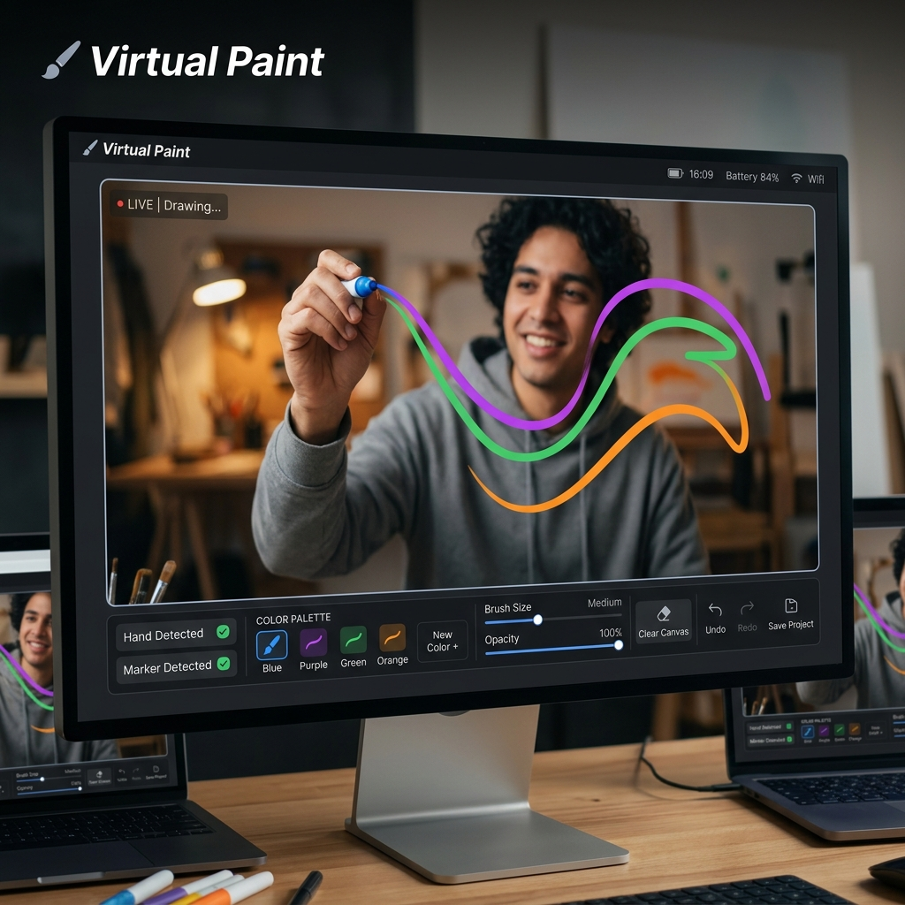

# VirtualPaint 🎨

A high-performance C++ application that leverages OpenCV for real-time color detection and virtual drawing. Track physical objects in the air and turn your webcam into a digital canvas!

## 🌟 Overview

**VirtualPaint** is a computer vision project developed using C++ and the OpenCV library. It uses HSV (Hue, Saturation, Value) color space tracking to identify specific objects in a video feed and translate their movement into digital brushstrokes on the screen.

### Key Features
- **Real-Time Tracking**: Ultra-low latency tracking using optimized C++ backend.
- **Multi-Color Support**: Pre-configured to detect Purple, Green, and Orange markers.
- **Dynamic Canvas**: Draws continuous trails that follow the tip of your tracked object.
- **Customizable**: Easy-to-tweak HSV ranges for adding support for any custom color.

## 🛠️ Technical Details

- **Language**: C++
- **Framework**: OpenCV 4.x
- **Core Logic**:
  - `findColor()`: Converts BGR frames to HSV and applies masks for target colors.
  - `getContours()`: Identifies the largest object and locates its topmost point for precision drawing.
  - `drawOnCanvas()`: Maintains a persistent vector of points to render the "paint" across frames.

## 🚀 Getting Started

### Prerequisites
- Visual Studio 2019 or newer.
- OpenCV 4.x installed and configured in your system environment.

### Setup
1. Clone the repository.
2. Open `VirtualPaint.sln` in Visual Studio.
3. Ensure your project properties are correctly pointing to your OpenCV `include` and `lib` directories.
4. Build and run in **x64 Release** mode for best performance.

## ⚖️ License

This project is licensed under the MIT License. See the [LICENSE](LICENSE) file for details.

---
**Maintained by**: Rajjit Laishram  
**Created**: October 2022  
**Updated**: April 2026
